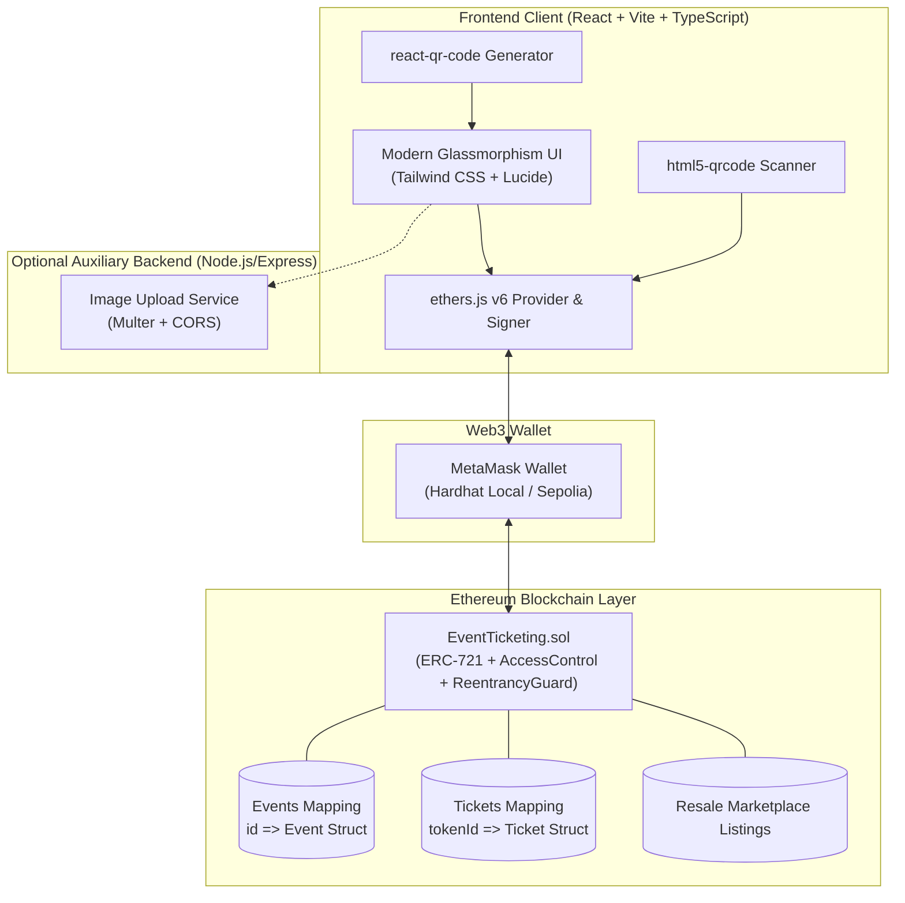

# TicketChain: Decentralized Event Ticketing System

> A production-grade decentralized event ticketing web application utilizing Solidity smart contracts and ERC-721 NFTs to create, purchase, transfer, resell, and verify digital event passes with smart contract-enforced anti-scalping rules.

---

## 📌 Project Overview

Traditional event ticketing industries face severe challenges: rampant ticket counterfeiting, predatory bots, and secondary ticket scalping markups exceeding 300% to 1000% of face value. **TicketChain** resolves these issues natively at the smart contract protocol layer using Ethereum ERC-721 Non-Fungible Tokens (NFTs).

Every ticket purchased is an immutable, cryptographically verifiable ERC-721 token. To eliminate secondary scalping, the smart contract overrides standard ERC-721 transfer mechanisms (`_update`), prohibiting direct peer-to-peer wallet transfers and requiring all secondary transactions to flow through the built-in marketplace where prices cannot exceed the organizer's predefined price ceiling.

---

## 🌟 Key Features

1. **NFT-Based Digital Passes**
   - Each ticket is represented by a unique ERC-721 token on Ethereum.
   - Distinct token IDs permanently linked to specific event IDs.
   - Non-custodial ownership managed directly via MetaMask.

2. **Blockchain-Enforced Anti-Scalping**
   - Event organizers configure an immutable maximum resale price upon event creation.
   - Resale attempts with asking prices above this cap are rejected on-chain by the EVM.
   - Direct `transferFrom` and `safeTransferFrom` transactions are blocked to prevent black-market bypasses.

3. **Dynamic QR Code Generation & On-Chain Verification**
   - High-contrast, dynamic QR codes generated in-browser for each ticket token.
   - Staff door scanner reads QR codes via camera or manual token lookup.
   - Verification checks token existence, event validity, ownership, and redemption state directly against the blockchain.

4. **Duplicate Entry & Fraud Prevention**
   - State variable `isRedeemed` is permanently flipped on-chain upon door check-in.
   - Second entrance attempts are immediately flagged as `ALREADY USED` duplicate entries.
   - Only authorized accounts with `VERIFIER_ROLE` can execute redemptions.

5. **Organizer Hub & Role-Based Access Control**
   - OpenZeppelin `AccessControl` managing `DEFAULT_ADMIN_ROLE`, `ORGANIZER_ROLE`, and `VERIFIER_ROLE`.
   - Organizers create events with custom ticket supply, face-value price, and anti-scalping price caps.
   - Real-time tracking of tickets sold, remaining capacity, and door verifier authorizations.

6. **Peer-to-Peer Resale Marketplace**
   - Sellers list unwanted tickets within smart contract price caps.
   - Atomic buy transactions transfer payment to seller (97.5%) and platform fee (2.5%) while transferring NFT ownership in a single transaction.

7. **On-Chain Audit Trail**
   - Comprehensive event indexing listening to `EventCreated`, `TicketPurchased`, `TicketResold`, and `TicketRedeemed`.
   - Direct deep-links to block explorers (Etherscan Sepolia or local node).

---

## 🏗️ Architecture



---

## 🛠️ Technology Stack

| Layer | Component | Technology / Library |
|---|---|---|
| **Frontend** | Framework | React 18, Vite, TypeScript |
| | Styling & Icons | Tailwind CSS, Lucide React, Glassmorphism design |
| | Web3 Library | ethers.js v6 |
| | QR Utilities | react-qr-code, html5-qrcode |
| | Routing | React Router v6 |
| **Blockchain** | Language | Solidity `^0.8.24` (cancun EVM) |
| | Development Suite | Hardhat, TypeChain, hardhat-toolbox |
| | Standards & Security | OpenZeppelin Contracts v5 (ERC-721, AccessControl, ReentrancyGuard) |
| | Testnet | Ethereum Sepolia (`11155111`), Hardhat Local (`31337`) |
| **Backend** | Server (Optional) | Express.js, Multer, UUID, CORS |
| **Hosting** | Web Deployment | Render Static Site & Web Service |
| | Source Control | Git & GitHub |

---

## 📂 Project Directory Structure

```
blockchain-event-ticketing/
├── contracts/                             # Hardhat Blockchain Project
│   ├── contracts/
│   │   └── EventTicketing.sol             # Core ERC-721 Anti-Scalping Smart Contract
│   ├── scripts/
│   │   ├── deploy.ts                      # Deployment script (saves ABI & address)
│   │   └── seed.ts                        # Local testnet data seeder
│   ├── test/
│   │   └── EventTicketing.test.ts         # 47 Unit & Integration tests (100% passing)
│   ├── hardhat.config.ts                  # Hardhat configuration (cancun EVM, viaIR)
│   ├── package.json
│   └── tsconfig.json
├── frontend/                              # React 18 + Vite + TypeScript Application
│   ├── src/
│   │   ├── components/                    # Reusable Web3 UI Components
│   │   │   ├── EventCard.tsx              # Event poster card with availability meter
│   │   │   ├── Navbar.tsx                 # Navigation with wallet status & network info
│   │   │   ├── NetworkWarning.tsx         # Unsupported network banner
│   │   │   ├── TicketCard.tsx             # Digital NFT pass with embedded QR code
│   │   │   ├── TransactionModal.tsx       # Transaction confirmation & explorer links
│   │   │   └── WalletButton.tsx           # MetaMask connection & account switcher
│   │   ├── constants/                     # Deployed addresses and contract ABIs
│   │   │   ├── deployments.json
│   │   │   └── EventTicketing.abi.json
│   │   ├── hooks/                         # Custom React Hooks
│   │   │   ├── useTransaction.ts          # Transaction state lifecycle manager
│   │   │   └── useWallet.ts               # MetaMask account & network sync
│   │   ├── pages/                         # Application Pages
│   │   │   ├── AdminPage.tsx              # System role administration
│   │   │   ├── EventDetailPage.tsx        # Event details & NFT ticket minting
│   │   │   ├── EventsPage.tsx             # Event catalog with search & filters
│   │   │   ├── LandingPage.tsx            # Commercial Web3 hero & feature showcase
│   │   │   ├── MarketplacePage.tsx        # Price-capped secondary resale marketplace
│   │   │   ├── MyTicketsPage.tsx          # Ticket wallet & resale listing modal
│   │   │   ├── OrganizerDashboard.tsx     # Event deployment & door staff manager
│   │   │   ├── ScannerPage.tsx            # Camera QR code ticket verifier
│   │   │   └── TransactionHistoryPage.tsx # Immutable on-chain audit log
│   │   ├── services/
│   │   │   └── web3Service.ts             # Ethers.js v6 contract client
│   │   ├── types/
│   │   │   └── index.ts                   # TypeScript interfaces
│   │   ├── App.tsx                        # Master routes & layout
│   │   ├── index.css                      # Tailwind base & glassmorphism utilities
│   │   └── main.tsx                       # React DOM entry point
│   ├── index.html
│   ├── package.json
│   ├── tailwind.config.js
│   ├── tsconfig.json
│   └── vite.config.ts
├── backend/                               # Optional Image Upload API
│   ├── src/
│   │   └── index.js                       # Express & Multer file server
│   └── package.json
├── .env.example                           # Template environment variables
├── .gitignore                             # Git ignore rules for node_modules, keys & build
├── render.yaml                            # Render Infrastructure as Code configuration
└── README.md                              # Complete system documentation
```

---

## 🔒 Smart Contract Security & Anti-Scalping Architecture

### Transfer Restriction Hook
To prevent unauthorized secondary ticket transfers that bypass the price ceiling, `EventTicketing.sol` overrides the OpenZeppelin ERC-721 internal hook:

```solidity
function _update(
    address to,
    uint256 tokenId,
    address auth
) internal override returns (address) {
    address from = _ownerOf(tokenId);
    if (from != address(0) && !_transferAllowed) {
        revert("EventTicketing: direct transfers disabled; use the resale marketplace");
    }
    return super._update(to, tokenId, auth);
}
```

- When minting (`from == address(0)`), the transaction succeeds.
- When reselling through `buyResaleTicket()`, the function temporarily sets `_transferAllowed = true`, executes the internal transfer atomically, and resets `_transferAllowed = false`.
- Any external call to `transferFrom` or `safeTransferFrom` reverts, guaranteeing that secondary sales adhere strictly to the organizer's maximum resale cap.

### Reentrancy & Input Protection
- `nonReentrant` modifiers on `buyTicket` and `buyResaleTicket`.
- Checks-Effects-Interactions pattern: internal state and listing removals are performed before external ETH transfers.
- Overpayment refund: if a user sends more ETH than the ticket price, the difference is refunded safely.

---

## 🧪 Automated Test Suite (47 Passing Tests)

The smart contract includes complete automated tests covering all 14 project requirements:

```bash
cd contracts
npx hardhat test
```

### Test Summary
- **Test 1: Event Creation**
  - Should create an event with correct parameters
  - Should revert if non-organizer creates event
  - Should revert on empty name or past date
  - Increments event IDs correctly
- **Test 2: Ticket Purchase**
  - Allows buyer to purchase ticket and emits `TicketPurchased` & `TicketMinted`
  - Forwards payment to organizer
  - Refunds overpayment to buyer
- **Test 3: Successful NFT Minting**
  - Mints ERC-721 token to buyer
  - Appends token ID to event and user collections
- **Test 4: Insufficient Payment**
  - Reverts when payment is below ticket price or zero
- **Test 5: Sold-Out Event**
  - Reverts when event ticket supply is exhausted
  - Accurately tracks remaining tickets
- **Test 6: Maximum Resale Price Enforcement**
  - Reverts resale listings above `maxResalePrice`
  - Allows resale listings at or below `maxResalePrice`
  - Reverts resale listings at zero price
- **Test 7: Successful Ticket Resale**
  - Completes resale, transfers NFT, and emits `TicketResold`
  - Sends 97.5% of sale price to seller and retains 2.5% platform fee
  - Removes token from active resale list upon sale
  - Reverts if buyer sends insufficient funds
- **Test 8: NFT Ownership After Resale**
  - Verifies new buyer is token owner
  - Verifies old seller no longer has ownership
- **Test 9: Unauthorized Ticket Minting**
  - Ensures contract does not expose an open public mint function
  - Reverts unapproved free ticket minting
- **Test 10: Invalid Ticket Redemption - Wrong Verifier**
  - Reverts when non-verifier calls `redeemTicket`
  - Allows authorized verifier to redeem and emit `TicketRedeemed`
- **Test 11: Duplicate Ticket Redemption**
  - Reverts second redemption attempt on the same ticket
  - Checks `isRedeemed` flag is permanently set to `true`
- **Test 12: Unauthorized Verifier**
  - Reverts redemption from accounts without `VERIFIER_ROLE`
  - Admin and organizer can grant/revoke `VERIFIER_ROLE`
- **Test 13: Unauthorized Ticket Transfers**
  - Reverts direct `safeTransferFrom` and `transferFrom` calls
  - Confirms transfers are permitted exclusively through `buyResaleTicket`
- **Test 14: Resale of Redeemed Tickets**
  - Reverts listing a redeemed ticket for resale
  - Reverts buying a resale ticket that was redeemed after listing
- **Role Management & Cancellation**
  - Admin can grant and revoke organizer roles
  - Ticket owners can cancel resale listings

---

## 🚀 Local Development & Setup

### 1. Prerequisites
- [Node.js](https://nodejs.org/) (v18 or v20 LTS recommended)
- [MetaMask](https://metamask.io/) browser extension

### 2. Clone the Repository
```bash
git clone <repository-url>
cd blockchain-event-ticketing
```

### 3. Smart Contracts Setup & Local Node
```bash
cd contracts
npm install

# Run automated tests
npx hardhat test

# Start local Ethereum test node (Terminal 1)
npx hardhat node

# In Terminal 2, deploy contracts and seed demo events
npx hardhat run scripts/deploy.ts --network localhost
npx hardhat run scripts/seed.ts --network localhost
```

### 4. Configure MetaMask for Local Hardhat Node
- **Network Name**: Hardhat Localhost
- **RPC URL**: `http://127.0.0.1:8545`
- **Chain ID**: `31337`
- **Currency Symbol**: `ETH`
- **Import Account**: Import one of Hardhat's pre-funded private keys (printed in Terminal 1).

### 5. Frontend Setup
```bash
cd ../frontend
npm install

# Start Vite development server
npm run dev
```
Open `http://localhost:5173` in your browser.

---

## 🌐 Ethereum Sepolia Testnet Deployment

1. Fund a deployment wallet with Sepolia ETH via a public faucet (e.g., [Google Cloud Web3 Faucet](https://cloud.google.com/application/web3/faucet/ethereum/sepolia)).
2. Configure `contracts/.env`:
   ```env
   SEPOLIA_RPC_URL=https://rpc.sepolia.org
   DEPLOYER_PRIVATE_KEY=your_private_key_without_0x
   ETHERSCAN_API_KEY=your_etherscan_key_optional
   ```
3. Deploy to Sepolia:
   ```bash
   cd contracts
   npx hardhat run scripts/deploy.ts --network sepolia
   ```
4. Update `frontend/.env.local`:
   ```env
   VITE_CONTRACT_ADDRESS=0xYourDeployedSepoliaAddress
   VITE_CHAIN_ID=11155111
   ```

---

## ☁️ Render Deployment Guide

The repository includes a ready-to-deploy `render.yaml` specification.

### Deploy Frontend (Static Site)
1. Link your GitHub repository in the [Render Dashboard](https://dashboard.render.com).
2. Create a new **Static Site**:
   - **Root Directory**: `frontend`
   - **Build Command**: `npm install && npm run build`
   - **Publish Directory**: `dist`
   - **Rewrite Rules**: Source: `/*` -> Destination: `/index.html` (SPA routing)
3. Set Environment Variables:
   - `VITE_CONTRACT_ADDRESS`: The deployed contract address.
   - `VITE_CHAIN_ID`: `11155111` for Sepolia or `31337` for local.

---

## 📄 License

This project is licensed under the MIT License.
